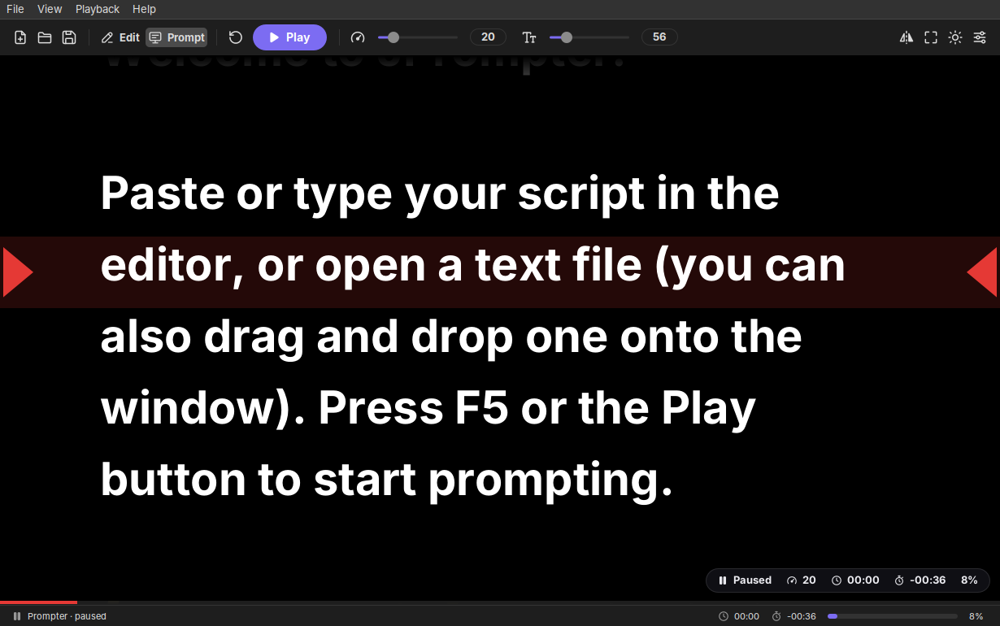
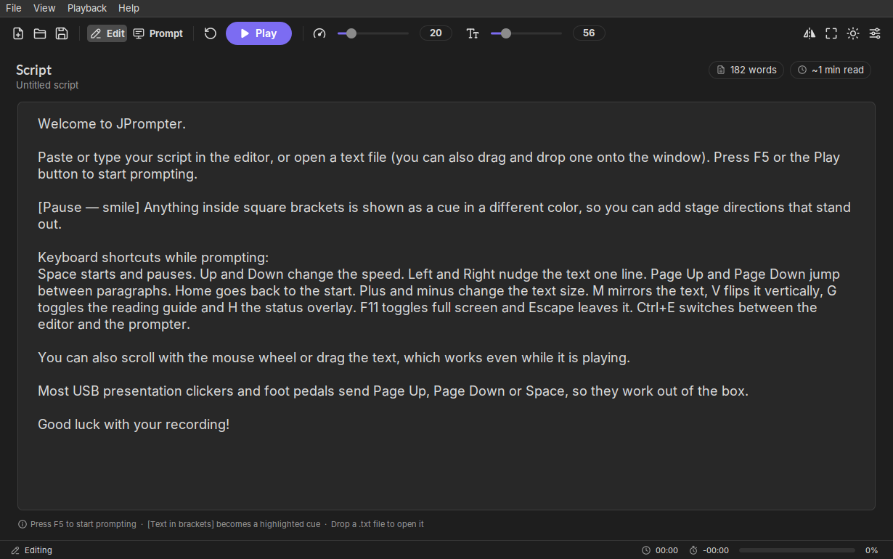
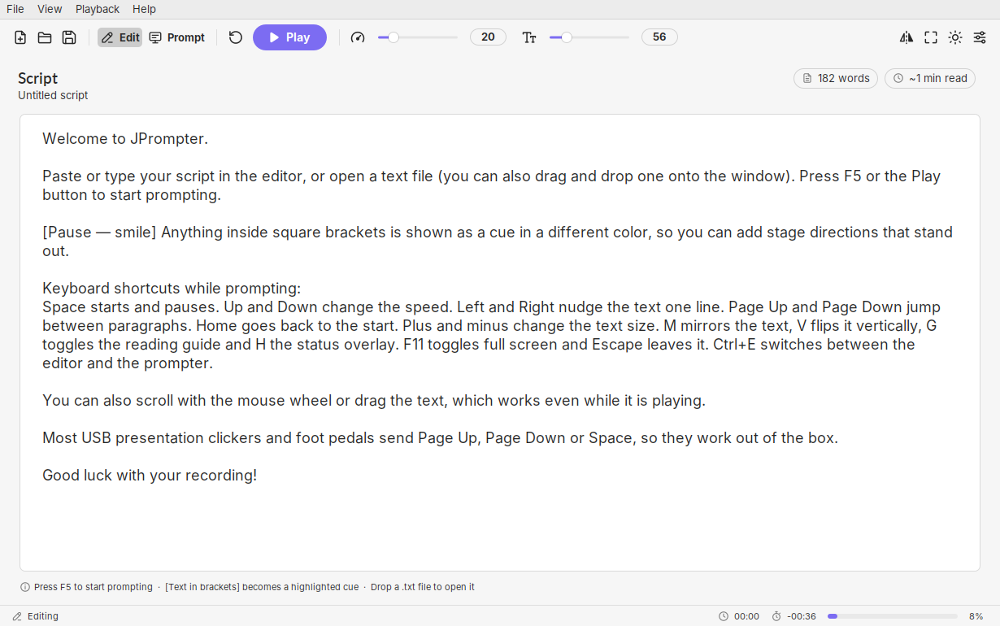
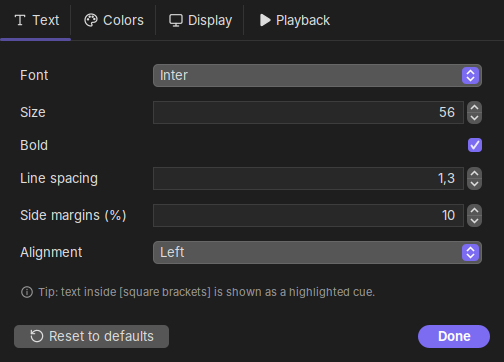

  

<h1 align="center">JPrompter</h1>

A free and open source teleprompter for your desktop, written in Java.

  
  

  

## Features

- **Script editor** with undo/redo, word count and an estimated reading time. You can open and save `.txt` and `.md` files, drag and drop a file onto the window, or paste from the clipboard and start right away.
- **Smooth scrolling** with adjustable speed. The speed scales with the text size, and a 3-2-1 countdown plays before a run starts from the top. Resuming after a pause is instant.
- **Pace by speed or by time**: set the speed yourself, or enter a duration (such as `3:00`) and the speed is calculated so the script ends exactly on time. The schedule stays on track even if you pause or scroll back.
- **Mirror mode**, horizontal and/or vertical, for teleprompter glass.
- **Reading guide**: a highlighted band with arrows at a position you can adjust. The top and bottom edges fade out.
- **Cues**: `[text in brackets]` is shown in a different color, for stage directions.
- **Customizable text**: font, size, weight, line spacing, margins, alignment and colors, with presets.
- **Full-screen mode** with the mouse cursor hidden, plus a status overlay showing elapsed time, time remaining and progress.
- **Remote friendly**: most USB presentation clickers and foot pedals work out of the box (Page Up, Page Down, Space).
- **Modern interface** with light and dark themes, built with [FlatLaf](https://www.formdev.com/flatlaf/).
- **English and Brazilian Portuguese**: switch any time under View → Language. Your script stays open.
- Settings are remembered between sessions.

  
  

## Build & run

You need Java 21 or newer and Maven.

The launcher scripts build the app on the first run and then start it:

    ./jprompter.sh [script.txt]        # Linux / macOS
    jprompter.bat [script.txt]         # Windows (or double-click it)

Add `--build` to rebuild after updating the code. You can also build and run by hand:

    mvn package
    java -jar target/jprompter-1.0.0.jar [script.txt]

The jar is self-contained, with its dependencies bundled.

## Keyboard shortcuts (prompter view)

| Key | Action |
|---|---|
| Space / Enter / F5 | Play / pause |
| ↑ / ↓ (Shift = ×5) | Faster / slower (in time mode: shorter / longer by 5 s) |
| T | Pace by speed / by time |
| ← / → | Nudge one line |
| PgUp / PgDn (Shift = screen) | Previous / next paragraph |
| Home / End | Start / end |
| + / - | Text size |
| M / V | Mirror horizontal / vertical |
| G / H | Toggle guide / status overlay |
| F or F11 / Esc | Enter / leave full screen |
| Ctrl+E | Switch editor ↔ prompter |
| F1 | Help |

  

## Translations

All UI text lives in properties files in `src/main/resources/jprompter/`:

- `messages.properties`: English (the default)
- `messages_pt_BR.properties`: Brazilian Portuguese

To add a language, copy `messages.properties` to `messages_<locale>.properties` (for example `messages_es.properties`), translate the values, and add an entry to the `Language` enum in `I18n.java`.

## Credits

- [FlatLaf](https://github.com/JFormDesigner/FlatLaf): look and feel and SVG icon support (Apache 2.0)
- [Inter](https://rsms.me/inter/) font by Rasmus Andersson (SIL Open Font License)
- [JSVG](https://github.com/weisJ/jsvg): SVG rendering (MIT)
- The icons and logo were drawn for this project.

## License

[GNU GPL v3.0](LICENSE)
